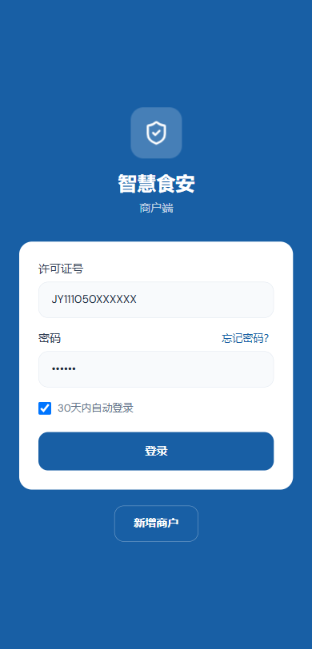
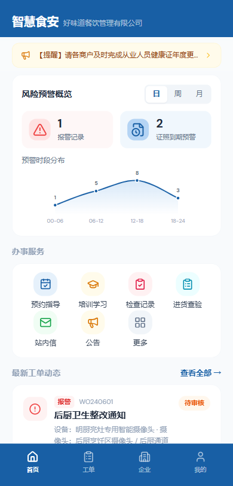
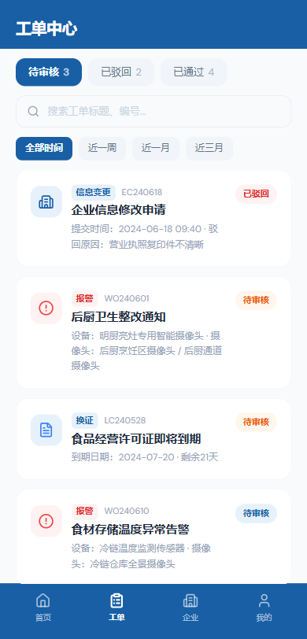
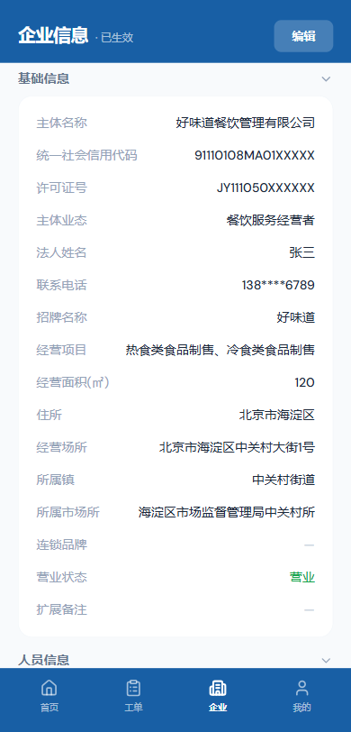
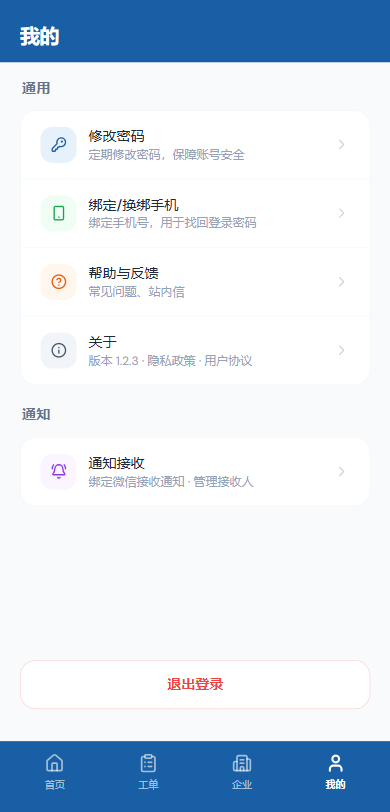

> 适用对象：平台入驻商户的操作人员（店长、食品安全管理员、后厨负责人等）
> 版本：v1.1 ｜ 更新时间：2026-10-28

## 目录

- [一、概述](#一概述)
- [二、主要功能](#二主要功能)
- [三、使用指南](#三使用指南)

---

## 一、概述

### 1.1 产品简介

「智慧食安」商户端是面向食品经营商户的移动端小程序，用于接收监管部门的整改通知、管理企业证照与人员信息、上报进货查验记录、绑定微信接收告警通知等。商户通过小程序即可完成信息建档、工单处理、证照管理等日常事务，实现食品安全管理的线上化。

底部导航栏共四个入口：**首页、工单、企业、我的**。

**核心模块：**

| 模块 | 说明 |
|---|---|
| 首页 | 风险预警概览、办事服务快捷入口、最新工单动态 |
| 工单 | 查看/处理监管部门下发的报警、换证、申诉等工单 |
| 企业 | 查看与维护企业基础信息、人员信息、企业证照 |
| 我的 | 修改密码、绑定手机、通知接收、退出登录 |

### 1.2 本次试运行范围

本次试运行由**门头沟区市场监督管理局**统筹，范围如下：

| 维度 | 范围 |
|---|---|
| 监管组织 | 1 个区市场监督管理局 + 15 个市场所（斋堂、雁翅、清水、潭柘寺、妙峰山、王平、军庄、大峪、城子、东辛房、大台、永定、龙泉、石龙、市集） |
| 监管主体 | 2,624 家食品经营主体（餐饮服务、食品销售、单位食堂、食品生产等业态） |
| 视频监控 | 千里眼设备 673 台，其中在线 426 台 |
| 商户端覆盖业务 | 企业建档、主体信息变更、整改反馈、申诉、证照维护、人员与健康证管理、进货查验、站内信、公告接收 |
| 监管部门接口 | 预警整改工单由所属市场所管理员审核（审批权在镇级） |

> 📌 试运行期间数据持续变化，请以系统实时显示为准。

### 1.3 访问入口

| 端 | 入口 |
|---|---|
| 商户端 | 微信小程序「食品安全智慧监管」，由监管人员下发入口 / 二维码，首次进入需完成注册绑定 |
| 管理端（监管） | https://food-safety-supervision.jingxizhigu.cn:21423/ （浏览器访问） |
| 原型预览 | 本地 HTML：智慧食安_商户小程序.html（商户端）、智慧食安_管理PC.html（管理端） |

> 📌 本手册中的商户端界面截图为演示环境截图，用于说明操作位置与字段；正式环境的界面细节以实际页面为准。

### 1.4 登录账号

商户端登录账号与初始密码由监管人员在建档审批通过后通过短信下发：

| 项目 | 说明 |
|---|---|
| 登录账号 | 食品经营许可证号（如 JY21109034241051） |
| 初始密码 | 由监管人员短信下发，首次登录需修改 |
| 密码规则 | 8–18 位，数字、字母、符号任意两种组合 |
| 短信验证码 | 用于捆绑手机、找回密码等，5 分钟内有效 |

> 📌 原型演示环境可使用演示许可证号 JY111050XXXXXX，短信验证码 123456。

---

## 二、主要功能

### 2.1 功能总览

| 模块 | 说明 |
|---|---|
| 首页 | 风险预警概览、办事服务快捷入口、最新工单动态 |
| 工单 | 查看/处理监管部门下发的报警、换证、申诉等工单 |
| 企业 | 查看与维护企业基础信息、人员信息、企业证照 |
| 我的 | 修改密码、绑定手机、通知接收、退出登录 |

### 2.2 核心处理流程（商户参与环节）

本节介绍商户在「智慧食安」业务闭环中的参与环节。

#### 流程一：AI 报警整改

```text
监管部门 AI 抓拍识别违规 → 人工确认采纳，生成整改工单下发
        │
        ▼
商户小程序 · 工单（收到整改通知）
        │
        ▼
商户整改并提交材料（整改说明 + 照片）
        │
        ▼
所属市场所（镇级）审核
        ├── 审核通过 → 工单已通过 · 预警状态已确认
        └── 驳回（附审批意见）→ 商户重新整改 → 再次提交（可多轮）
```

#### 流程二：证照到期换证

```text
系统每日 02:00 扫描证照有效期 → 命中提醒节点（到期前 90 / 60 / 30 / 7 / 3 天）
        │
        ▼
商户小程序 · 工单（收到换证提醒；证照过期当天系统自动生成工单）
        │
        ▼
商户在线办理换证并上传新证照
        │
        ▼
所属市场所审核 → 通过归档 / 驳回补材料
```

证照范围包括 4 类：**营业执照、食品经营许可证、食品生产许可证、健康证**（含从业人员健康证）。

#### 流程三：商户申诉

```text
商户对报警 / 工单有异议 → 在小程序发起申诉（附证据，如监控录像）
        │
        ▼
监管部门审核
        ├── 审核通过 → 撤销原报警 / 工单
        └── 驳回 → 需先整改，再重新提交申诉
```

#### 流程四：主体信息变更

```text
商户提交变更申请（企业信息变更前后对比）
        │
        ▼
监管部门审核
        ├── 审核通过 → 变更生效
        └── 驳回 → 商户修改后重新提交
```

变更审批期间企业信息只读，通过后自动生效。

---

## 三、使用指南

### 3.1 登录与找回密码

{height=11cm}

**登录**

1. 打开小程序，进入登录页。
2. 输入许可证号（如 JY21109034241051）。
3. 输入密码（首次登录使用监管下发的初始密码，规则：8–18 位，数字/字母/符号任意两种组合）。
4. 可选勾选「30 天内自动登录」，免去重复登录。
5. 点击登录，进入首页；首次登录需按提示设置新密码并绑定手机号。

> 📌 提示：初始密码由监管人员通过短信发送至注册手机号，登录后建议立即修改密码。

**忘记密码**

1. 在登录页点击「忘记密码？」。
2. 输入注册手机号，点击「获取验证码」。
3. 输入收到的短信验证码，设置新密码。
4. 点击确认，完成密码重置后重新登录。

### 3.2 首次建档（新增商户）

首次使用且平台尚未录入商户信息时，需先完成建档。分为两步：身份验证 → 选择注册方式。

**进入建档**

1. 在登录页点击「新增商户」按钮。
2. 进入首次验证页，填写：主体名称、统一社会信用代码、法人姓名、联系电话（均为必填）。
3. 可选点击「微信一键授权」，将账号与当前微信绑定。
4. 点击「确认并进入」。

**选择注册方式**（两种方式均需提交监管审核）

- 绑定已有商户：平台已录入你的商户信息时选择。搜索并选择商户 → 输入监管线下提供的验证码 → 提交绑定申请。
- 新增商户信息：平台暂无你的商户信息时选择。填写企业信息创建新档案。

**填写新增企业信息**

1. 上传许可证文件：上传食品经营许可证（支持 png / jpeg / pdf）。
2. OCR 识别（推荐）：点击「OCR 识别许可证信息」，系统自动识别并填入主体名称、统一社会信用代码、许可证号、主体业态、法人姓名。

   > 📌 提示：OCR 识别结果会自动填入并高亮显示。请务必核对识别结果是否与证件一致，如有误差请手动修正。

3. 填写主体信息（带 * 为必填）：主体名称、统一社会信用代码（18 位）、许可证号、主体业态、法人姓名、联系电话、手机验证码。
4. 填写经营信息：招牌名称、经营项目、经营面积、住所、所属镇、经营场所、所属市场所、连锁品牌、营业状态、扩展备注。
5. 点击底部「提交」，等待监管审核。

**审核状态说明**

| 状态 | 说明 | 操作 |
|---|---|---|
| 待审批 | 已提交，等待监管审核（1–3 个工作日） | 耐心等待 |
| 已驳回 | 审核未通过，附驳回原因 | 点击「重新填写」修改后再次提交 |
| 已通过 | 建档完成 | 使用初始密码登录（短信发送） |

### 3.3 首页功能

{height=11cm}

- 公告滚动条：滚动展示平台通知，点击查看详情。
- 风险预警概览：展示报警记录与证照到期预警数量；可切换统计周期（日 / 周 / 月）；下方为预警时段分布折线图。
- 办事服务（快捷功能）：预约指导、培训学习、检查记录（建设中）；进货查验、站内信、公告、更多。
- 最新工单动态：展示最新工单列表，点击可跳转工单详情，点击「查看全部 →」进入工单页。

### 3.4 工单管理

{height=11cm}

**列表与筛选**

1. 点击底部「工单」进入工单页。
2. 顶部按状态筛选：待审核 / 已驳回 / 已通过。
3. 支持按关键词搜索（工单标题、编号），以及时间筛选（全部 / 近一周 / 近一月 / 近三月）。

**工单类型**

| 类型 | 说明 | 示例 |
|---|---|---|
| 整改工单 | AI 报警采纳、证照到期后下发的整改要求 | 后厨未戴口罩整改、健康证过期换证 |
| 申诉工单 | 商户对预警 / 工单有异议时发起 | 对误判报警提出申诉 |
| 变更工单 | 商户提交的主体信息变更、新商户注册 | 变更经营地址、法人手机号 |

**详情与处理**

1. 点击任意工单进入详情页，查看工单内容。
2. 根据状态处理：待审核→按要求整改后反馈；已驳回→查看驳回原因，整改后重新提交；已通过→查看归档记录，有异议可发起申诉。

> 📌 提示：对待审核/已驳回的报警类工单，请及时整改并反馈，逾期可能影响后续监管评价。

### 3.5 企业信息管理

{height=11cm}

点击底部「企业」进入企业页。

- 审批进度：企业信息有修改审批时，顶部展示审批进度（提交审批 → 监管审核 → 已生效）。
- 基础信息：查看企业完整档案；点击「编辑」可修改（提交后进入审批，审批期间只读，通过后自动生效）。
- 人员信息：从业人员（含健康证有效期）、食品安全管理员（含培训证书编号）。
- 企业证照：查看营业执照、食品经营许可证、食品生产许可证、从业人员健康证及其有效期；点击「上传证照」可新增（图片格式 JPG / PNG，单张 ≤10MB）。证照到期日务必与证件一致，系统据此在到期前 90 / 60 / 30 / 7 / 3 天推送提醒。
- 变更记录：查看企业信息的最近更新时间与历史变更记录。

### 3.6 通知接收（微信绑定）

在「我的 → 通知接收」中管理通知接收方式，支持多成员绑定微信接收通知。

**绑定我的微信**

1. 进入「我的 → 通知接收」。
2. 在「我的微信接收」区域点击「绑定微信」。
3. 强制录入名字（标识）：填写真实姓名作为标识，便于管理端识别接收人。
4. 点击「确认绑定」，弹出微信订阅消息授权，点击「允许」完成绑定。

> 📌 提示：名字（标识）为必填项，不填写无法完成绑定。

**管理通知接收人**

- 查看清单（需短信验证）、编辑备注、移除成员；单个账号最多绑定 10 个成员。

### 3.7 办事服务

**进货查验**

1. 首页 → 办事服务 → 点击「进货查验」。
2. 查看列表：默认展示已登记的货物（货物名、描述、附件、时间）。
3. 新增货物：点击右下角蓝色「＋」圆形按钮，填写货物名（必填）、货物描述（可上传附件），点击保存。
4. 编辑/查看详情：点击列表中的货物可查看或修改。
5. 删除货物：在详情表单中点击「删除货物」。

**站内信**

1. 首页 → 办事服务 → 点击「站内信」。
2. 查看列表；写站内信：点击右下角蓝色「＋」按钮，填写主题与内容（可上传附件、语音输入），点击发送。
3. 回复：打开某条站内信，可回复对方。

**公告**：首页 → 办事服务 → 点击「公告」，查看平台发布的公告与提醒。

### 3.8 个人中心

{height=11cm}

点击底部「我的」进入个人中心。

- 修改密码：输入当前密码、新密码、确认新密码，点击确认修改。首次登录后请务必修改初始密码。
- 绑定 / 换绑手机：换绑时先验证原手机号（短信验证码），再绑定新手机号；手机号用于找回登录密码。
- 其他：帮助与反馈、关于（版本信息 / 隐私政策 / 用户协议）、退出登录。

### 3.9 常见问题（FAQ）

**Q1：登录提示密码错误怎么办？**
答：检查许可证号是否正确；如忘记密码，点击「忘记密码」通过手机号重置。

**Q2：OCR 识别结果准确吗？**
答：OCR 为辅助录入功能，识别后请务必人工核对识别内容与证件一致，不一致请手动修改。

**Q3：建档提交后多久能通过审核？**
答：监管人员将在 1–3 个工作日内完成审核，请耐心等待；审核进度可在首页/企业页查看。

**Q4：绑定微信时为什么必须填写名字？**
答：名字作为接收人标识，便于管理端识别是哪个成员在接收通知，属于必填项。

**Q5：通知接收人最多能绑几个？**
答：单个账号最多绑定 10 个成员；查看清单、移除成员等管理操作需短信验证。

**Q6：工单被驳回了怎么办？**
答：查看驳回原因，整改后重新提交；如有异议可发起申诉。

**Q7：企业信息修改后为什么不能马上生效？**
答：信息修改需提交监管审批，审批期间信息只读，通过后自动生效。

### 3.10 注意事项

1. 密码安全：首次登录后立即修改初始密码，勿将密码告知他人。
2. 信息核对：OCR 识别、表单填写均请核对无误后提交，避免因信息错误被驳回。
3. 及时处理工单：对报警、换证类工单请及时整改反馈，避免逾期。
4. 证照有效期：关注首页「证照到期预警」，提前办理延续，避免证照过期。
5. 通知接收：绑定微信并授权订阅消息，确保能及时收到整改、告警通知；成员离职请及时移除。
6. 进货查验：进货时及时登记，上传质检报告等附件，留存凭证备查。

---

*本手册基于「智慧食安」商户端小程序当前版本编写，如界面或流程有更新，请以实际页面为准。*
