> 适用对象：区市场监督管理局、镇（街道）市场监督管理所的平台使用人员
> 版本：v2.0 ｜ 更新时间：2026-10-28（依据线上试运行环境实测整理）

## 目录

- [一、概述](#一概述)
- [二、主要功能](#二主要功能)
- [三、使用指南](#三使用指南)

---

## 一、概述

### 1.1 产品简介

「食品安全智慧监管平台」（简称「智慧食安」）是面向区、镇（街道）两级市场监管部门的 PC 端管理平台。平台以食品经营主体档案为基础，打通明厨亮灶视频、AI 违规识别、证照到期预警、工单审批、公告下发与站内沟通，形成「发现—处置—整改—审核—归档」的线上闭环。

浏览器访问，无需安装客户端。界面由三部分组成：

- **左侧导航栏**：11 个功能模块，可点击底部「«」折叠为图标模式；带红色角标的菜单表示有未处理事项（如「风险预警 99+」「审批记录 6」「站内信 4」）。
- **顶部栏**：左侧为当前页面包屑，右侧依次为通知铃铛、全屏按钮、当前账号（姓名 / 角色 · 数据范围）、退出系统。
- **内容区**：各模块的列表、详情与操作页面。

**核心模块：**

| 模块 | 说明 |
|---|---|
| 数据中心 | 全区综合监管驾驶舱，核心指标与点位分布一屏总览 |
| 主体管理 | 企业台账、从业人员、证照、分组管理 |
| 视频监控 | 明厨亮灶实时预览，支持轮播与多画面 |
| 设备关联 | 移动千里眼设备与商户的关联管理 |
| 风险预警 | AI 报警记录与证照到期预警的人工复核与处置 |
| 审批记录 | 整改 / 申诉 / 变更工单的统一审批入口 |
| 站内信 | 与商户双向沟通，可主动发起 |
| 公告管理 | 向辖区商户下发监管公告 |
| 知识库 | 腾讯 ima 知识库服务（法规、案例、操作指南） |
| 通知信息 | 平台内部通知中心 |
| 系统管理 | 用户、组织架构、AI 报警规则、证照扫描规则 |

### 1.2 访问地址与登录账号

| 项目 | 内容 |
|---|---|
| 访问地址 | https://food-safety-supervision.jingxizhigu.cn:21423/ |
| 区级账号 | admin ／ mtg#202610 |
| 账号身份 | 超级管理员 · 区级管理员 · 全区 |
| 推荐浏览器 | Chrome / Edge 最新版，分辨率建议 1920×1080 及以上 |

> 🔐 密码规则：8–18 位，须为数字、字母、符号中的**任意两种**组合。请勿使用纯数字、纯字母或含中文的密码。首次登录后建议立即修改初始密码。

### 1.3 本次试运行范围

本轮试运行面向**门头沟区**全域，覆盖区局与全部市场所：

| 维度 | 范围 |
|---|---|
| 组织架构 | 1 个区市场监督管理局 + 15 个市场所（斋堂、雁翅、清水、潭柘寺、妙峰山、王平、军庄、大峪、城子、东辛房、大台、永定、龙泉、石龙、市集） |
| 监管主体 | 2,624 家食品经营主体（含餐饮服务、食品销售、单位食堂、食品生产等业态） |
| 视频监控 | 千里眼设备 673 台，其中在线 426 台、离线 219 台，尚未关联商户 144 台 |
| 风险预警 | AI 报警（7 类违规行为识别）+ 证照到期预警（营业执照 / 食品经营许可证 / 食品生产许可证 / 健康证） |
| 业务闭环 | 预警复核 → 整改工单 → 商户整改 → 镇级审批 → 归档；含申诉工单、主体变更工单 |
| 辅助功能 | 公告下发、站内信沟通、知识库、通知信息、系统配置 |

> 📌 试运行数据实时变化，本手册中的数量为 2026-10-28 实测值，仅用于说明量级与界面位置，请以系统实时显示为准。

### 1.4 角色与权限

平台按「区—镇（街道）」两级分权，账号由区级超级管理员在「系统管理 → 用户管理」中创建。

| 角色 | 数据范围 | 核心权限 | 约束 |
|---|---|---|---|
| 区级管理员 | 全区 | 全区数据查看与统计、主体建档、风险预警人工确认、公告与站内信下发、系统配置 | **无工单审批权**（审批记录仅查看） |
| 镇级管理员 | 本所辖区 | 本所数据查看、风险预警人工确认、**工单审批（通过 / 驳回）**、公告与站内信下发 | 归属镇已锁定，仅能选择本镇主体；不能新增用户 |
| 商户负责人 | 本企业 | 商户端（小程序）报送信息、整改反馈、申诉 | 仅可见本企业数据 |

**区 / 镇关键差异：**

- 「审批记录」：区级页面提示「区级仅查看，审核权全归镇级」；镇级拥有「审批通过 / 驳回」按钮。
- 「主体管理」：镇级新建企业时的「所属市场所」已锁定为本所，无法跨镇选择。
- 「分组管理」：分组按创建人隔离，只能查看与管理自己创建的分组；镇级账号只能选择本镇主体。
- 「公告管理」：区级可按全区或自选镇下发；镇级仅能向本镇下发；两者均只能删除本人创建的公告。
- 「系统管理」：仅区级可见；其中「新增用户」仅超级管理员可操作。

### 1.5 界面通用操作

- **筛选与查询**：列表页顶部为筛选区，填写后点「搜索」生效，「重置」恢复默认条件。
- **分页**：列表底部可切换每页 10 / 20 / 50 条，支持跳转指定页。
- **详情查看**：多数列表行末提供「详情」或「查看详情」，以右侧抽屉或独立页面展示完整信息。
- **系统配置**：页面右下角的齿轮按钮打开「系统配置」抽屉，可设置整体风格（浅色 / 深色 / 自动）、主题色、导航模式、页宽、页签风格、灰色模式、色弱模式、Logo 显示、页签持久化，并提供「清空缓存」。
- **通知铃铛**：顶部铃铛显示未读通知数，点击进入「通知信息」。

---

## 二、主要功能

### 2.1 功能总览

| 模块 | 关键能力 |
|---|---|
| 数据中心 | 本月 AI 告警、待处理事项、证照到期（1 月内）、高风险指数、监管企业总数 5 项指标；告警排行 TOP5（日 / 周 / 月）；证件 3 个月临期清单；监管点位分布图；AI 报警趋势（30 天）；待审批事项；实时监控缩略 |
| 主体管理 | 主体检索与多条件筛选、导出台账（商户台账 / 人员台账 Excel）、分组管理、新增企业（三步建档）、企业详情（基础信息、从业人员、食品安全监理员、企业证照、变更记录、工单记录、AI 报警记录、进货查验）、编辑、解绑手机 |
| 视频监控 | 市场所 → 企业 → 摄像头三级树、按设备状态与开关状态筛选、实时预览、2×2（4 路）多画面、轮播、设备详情 |
| 设备关联 | 设备统计（总数 / 在线 / 未关联 / 离线）、自动匹配（同步千里眼设备）、手动关联、改关联、解绑、导出设备台账 Excel |
| 风险预警 | 四状态分类（待审核 / 待整改 / 已确认 / 已撤销）、按 AI 报警与证照到期两类查看、人工确认采纳 / 不采纳、AI 抓拍截图与报警详情 |
| 审批记录 | 流转中 / 已通过两类视图、按类型与紧急程度筛选、变更前后对比、操作记录追溯、审批通过 / 驳回（意见必填） |
| 站内信 | 沟通中 / 已关闭两类视图、主动发起（指定主体 / 自定义分组）、回复（表情、附件）、关闭会话 |
| 公告管理 | 全区 / 指定镇下发、全部主体 / 自定义分组发送、公告查看与删除 |
| 知识库 | 内嵌腾讯 ima 知识库 |
| 通知信息 | 全部 / 未读 / 已读、标记已读 |
| 系统管理 | 用户管理、组织架构、AI 报警规则、证照扫描规则 |

### 2.2 核心业务主流程

#### 主流程一：AI 报警处置

```text
摄像头实时抓拍 → AI 识别违规（未戴帽子/头套、未戴口罩、未戴手套、抽烟、玩手机、明火、鼠患）
        │
        ▼
风险预警 · 待审核（监管人工复核，查看抓拍截图与置信度）
        │
        ├── 不采纳 ──────────────► 已撤销（误报，流程结束，不生成工单）
        │
        └── 确认采纳 ────────────► 待整改（转为整改工单，下发商户整改）
                                        │
                                        ▼
                          商户端 · 工单（整改并提交说明与照片）
                                        │
                                        ▼
                          审批记录 · 流转中（镇级管理员审核）
                                        │
                              ├── 审批通过 ──► 工单已通过（归档），预警状态 → 已确认
                              │
                              └── 驳回（填写审批意见）──► 已驳回，商户整改后重新提交，
                                                          回到待审核，可多轮往复
```

**关键点：**

1. 待审核报警的处置入口在「风险预警 → 查看详情 → 人工确认」，确认后提示「已确认采纳」或「已标记不采纳」。
2. 采纳后预警进入「待整改」，并在审批记录中形成整改工单；完成整改并通过审核后，预警状态变为「已确认」。
3. 若主体「管理属性」为「普通预警需人工确认」，其普通级别预警同样需人工复核；「普通预警自动通过」则系统自动放行。

#### 主流程二：证照到期预警处置

```text
证照扫描规则：每日凌晨 02:00 扫描 → 命中提醒节点（到期前 90 / 60 / 30 / 7 / 3 天）
        │
        ▼
风险预警 · 证照到期预警（同一商户 + 同一证件类型合并为一条）
        │
        ├── 人工确认通过 ──► 待整改（生成整改工单，下发商户换证）
        │
        └── 人工确认不通过 ──► 已撤销（信息有误 / 已换证未更新）
        │
        ▼
证照过期当天 → 系统自动生成整改工单（无需另行确认）
        │
        ▼
商户上传新证照 → 镇级审批（通过归档 / 驳回补材料）
```

**关键点：** 扫描范围覆盖 4 类证照——营业执照、食品经营许可证、食品生产许可证、健康证；同一商户同类型多条预警合并推送，避免重复打扰。

#### 主流程三：商户工单审批（镇级专属）

```text
商户端提交（整改反馈 / 申诉 / 主体变更）
        │
        ▼
审批记录 · 流转中（待审核）
        │
        ├── 审批通过 → 已通过（归档）；变更工单即时生效、整改工单使预警转「已确认」、申诉工单撤销原预警
        │
        └── 驳回（审批意见必填，限 500 字）→ 已驳回 → 商户修改后重新提交 → 回到待审核
```

#### 分支流程

| 分支 | 触发场景 | 系统行为 |
|---|---|---|
| 误报撤销 | 抓拍属误报、置信度低、非营业时段 | 待审核 → 不采纳 → 已撤销，不生成工单 |
| 驳回重提 | 整改不到位、材料缺失、变更信息有误 | 工单回到商户侧「已驳回」，重新提交后返回待审核 |
| 商户申诉 | 商户对预警或工单有异议 | 生成申诉工单，审批通过后撤销原预警 |
| 主体信息变更 | 商户修改企业名称、法人、经营场所等 | 生成变更工单，附变更前后对比；审批期间信息只读，通过后生效 |
| 账号注册审批 | 商户端自助注册/绑定主体 | 生成变更工单（来源：商户注册），审批通过后开通商户账号 |
| 解绑手机 | 商户人员离职、手机号变更 | 在主体列表点「解绑手机」，解除微信与手机号绑定 |

### 2.3 工单类型与状态对照

| 工单类型 | 触发来源 | 商户侧处理 | 审批通过后 |
|---|---|---|---|
| 整改工单 | AI 报警采纳、证照到期 | 整改说明 + 照片上传 | 预警转「已确认」 |
| 申诉工单 | 商户对预警/工单有异议 | 申诉说明 + 证据 | 撤销原预警 |
| 变更工单 | 商户修改主体信息、新商户注册 | 提交变更前后内容 | 变更生效 / 开通账号 |

| 对象 | 状态取值 | 说明 |
|---|---|---|
| 风险预警 | 待审核 | 等待人工复核（仅 AI 报警与需人工确认的证照预警） |
| 风险预警 | 待整改 | 已采纳，等待商户整改与审核 |
| 风险预警 | 已确认 | 整改完成并审核通过 |
| 风险预警 | 已撤销 | 人工不采纳 |
| 工单 | 待审核 | 商户已提交，等待镇级审核 |
| 工单 | 已驳回 | 审核不通过，商户可修改后重新提交 |
| 工单 | 已通过 | 审核通过并归档 |

### 2.4 系统内置规则

**AI 报警规则**（系统管理 → AI 报警规则，可保存调整）：

| 检测类型 | 检测间隔 | 置信度阈值 |
|---|---|---|
| 未戴帽子/头套 | 5 分钟 | ≥80% |
| 未戴口罩 | 1 分钟 | ≥75% |
| 未戴手套 | 1 分钟 | ≥75% |
| 抽烟 | 3 分钟 | ≥85% |
| 玩手机 | 5 分钟 | ≥90% |
| 明火 | 5 分钟 | ≥90% |
| 鼠患 | 3 分钟 | ≥80% |

**证照扫描规则**（系统管理 → 证照扫描规则，只读展示）：

| 配置项 | 规则 |
|---|---|
| 扫描频率 | 每日扫描一次 |
| 扫描时点 | 每日凌晨 02:00 执行 |
| 合并策略 | 同商户 + 同证件类型合并为一条推送 |
| 提醒节点 | 到期前 90 / 60 / 30 / 7 / 3 天 |
| 自动工单 | 证照过期当天自动生成整改工单 |
| 证照类型 | 营业执照、食品经营许可证、食品生产许可证、健康证 |

---

## 三、使用指南

### 3.1 登录与退出

{width=15cm}

**登录**

1. 浏览器打开 https://food-safety-supervision.jingxizhigu.cn:21423/ ，系统自动跳转登录页。
2. 输入账号（如 admin）。
3. 输入密码（区分大小写，注意 # 等符号使用英文半角）。
4. 点击「登录」，登录成功后进入「数据中心」。

**退出**：点击右上角「退出系统」，返回登录页。

> 📌 若登录失败，请先确认账号是否存在（区级管理员可在「系统管理 → 用户管理」核对）、密码是否满足「8–18 位、数字/字母/符号任意两种」的规则；连续失败请联系区级超级管理员重置。

**常见界面元素**

| 位置 | 元素 | 作用 |
|---|---|---|
| 左上 | Logo + 平台名称 | 点击返回数据中心 |
| 左侧 | 导航菜单 | 切换 11 个功能模块 |
| 顶部 | 面包屑 | 显示当前所在模块 |
| 顶部 | 🔔 铃铛 | 未读通知入口 |
| 顶部 | 全屏图标 | 全屏 / 退出全屏 |
| 顶部 | 账号区 | 姓名、角色 · 数据范围 |
| 右下 | ⚙ 齿轮 | 系统配置（主题、导航模式等） |

### 3.2 数据中心

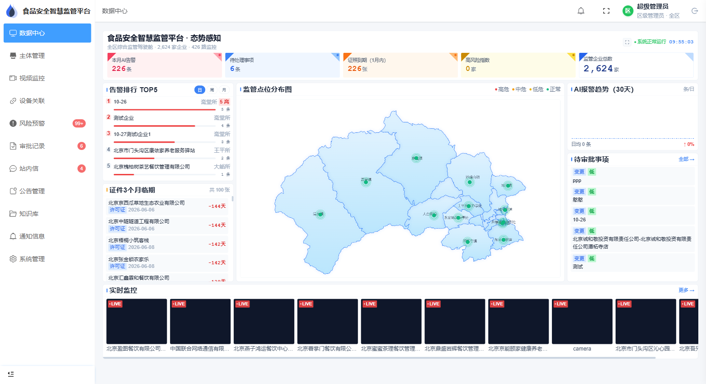{width=15cm}

数据中心是全区综合监管驾驶舱，页面标题下方实时显示「全区综合监管驾驶舱 · X 家企业 · X 路监控」，右上角为「系统正常运行」状态与实时时钟，并提供「全屏展示」（适合投屏到指挥大屏）。

**五张指标卡**（自左至右）：

| 指标 | 含义 | 说明 |
|---|---|---|
| 本月 AI 告警 | 当月 AI 识别告警条数 | 反映违规活跃度 |
| 待处理事项 | 待审批 / 待处置工单数 | 与「审批记录」角标对应 |
| 证照到期（1 月内） | 30 天内到期证照张数 | 提前介入换证 |
| 高风险指数 | 高风险主体数量 | 0 表示无高风险主体 |
| 监管企业总数 | 辖区在管主体数 | 与主体管理总数一致 |

**左栏**

- **告警排行 TOP5**：按日 / 周 / 月切换，列出告警最多的 5 家企业及其所属市场所与条数，用于锁定重点监管对象。
- **证件 3 个月临期**：列出 3 个月内到期的证照（企业名、证件类型、到期日、剩余天数），已过期显示负数天数（如 -144 天），需优先督办。

**中栏**：**监管点位分布图**——门头沟区行政区划图，按「高危 / 中危 / 低危 / 正常」着色，点击点位可查看该点位详情。

**右栏**

- **AI 报警趋势（30 天）**：折线图，显示日均条数与环比。
- **待审批事项**：最近待审批工单（类型标签 + 紧急程度 + 企业名），点击「全部 →」跳转审批记录。

**底部**：**实时监控**——10 路在线画面缩略图（标注 LIVE 与企业名），点击「更多 →」进入视频监控。

### 3.3 主体管理

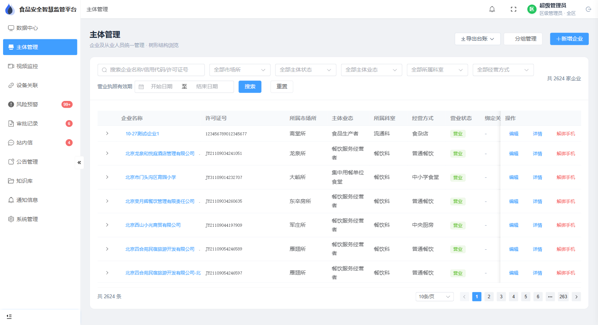{width=15cm}

#### 3.3.1 企业台账与检索

**筛选区**

| 控件 | 说明 |
|---|---|
| 搜索框 | 支持企业名称 / 统一社会信用代码 / 许可证号模糊检索 |
| 全部市场所 | 按市场所筛选（区级可选全部，镇级锁定本所） |
| 全部主体状态 | 营业 / 停业 / 注销 |
| 全部主体业态 | 食品销售经营者、餐饮服务经营者、单位食堂、集中用餐单位食堂、小餐饮、小餐饮店、小餐饮服务、食品生产者 |
| 全部所属科室 | 按监管科室筛选（如流通科、餐饮科） |
| 全部经营方式 | 按经营方式筛选（如普通餐饮、食杂店、中央厨房、中小学食堂、机关食堂、职工食堂） |
| 营业执照有效期 | 选择开始日期至结束日期区间 |
| 搜索 / 重置 | 应用或清空筛选条件 |

**列表列**：企业名称、许可证号、所属市场所、主体业态、所属科室、经营方式、营业状态、绑定关系、最近工单、操作。

- 企业名称前「>」可展开树形子节点（连锁门店、分支机构）。
- 「绑定关系」显示商户端绑定的手机号/微信，未绑定显示「-」。
- 「最近工单」显示该企业工单条数，点击可查看。

**行内操作**：编辑 / 详情 / 解绑手机。

> 📌 「解绑手机」用于商户人员离职或手机号变更，解除微信与手机号绑定；主体尚未绑定手机时按钮会提示无需解绑。

#### 3.3.2 导出台账

点击「导出台账」下拉，可选择：

- **导出商户台账（Excel）**：导出当前筛选条件下全部主体信息。
- **导出人员台账（Excel）**：导出从业人员信息（含健康证）。

> 导出为原值，不做脱敏处理，请注意台账的保管与流转范围。

#### 3.3.3 分组管理

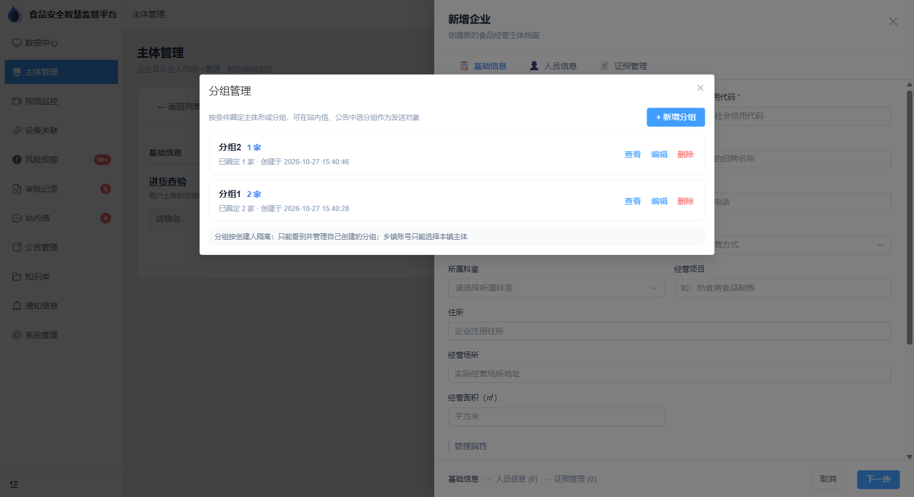{width=15cm}

分组用于在「站内信」「公告」中作为发送对象，避免逐家勾选。

1. 点击「分组管理」，弹窗展示已建分组（分组名、主体数、创建时间）。
2. 点击「+ 新增分组」，填写分组名称，按条件圈定主体后保存。
3. 行内「查看」可核对成员名单，「编辑」调整名单，「删除」移除分组（删除后无法再被选中）。

> 📌 分组按创建人隔离：只能看到并管理自己创建的分组；镇级账号只能选择本镇主体。

#### 3.3.4 新增企业（三步建档）

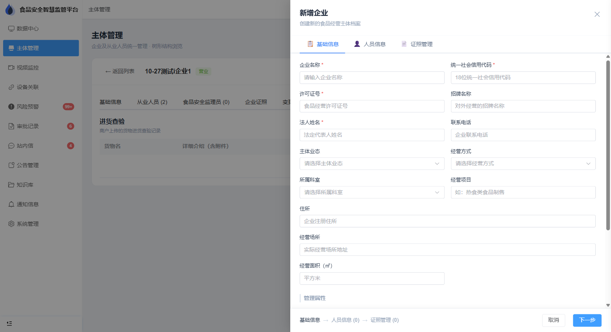{width=15cm}

1. 点击右上角「新增企业」，进入建档向导。
2. **第一步 基础信息**：企业名称\*、统一社会信用代码\*（18 位）、许可证号、招牌名称、法人姓名\*、联系电话、主体业态、经营方式、所属科室、经营项目、住所、经营场所、经营面积（㎡）、管理属性、所属市场所\*、营业状态、备注。
   - **管理属性**：`人工确认预警`／`普通预警自动通过`／`普通预警需人工确认`，决定该主体的预警是否需人工复核。
3. 点击「下一步」进入**第二步 人员信息**：逐条添加从业人员（姓名\*、性别、身份证号\*、职务、联系电话、健康证编号、健康证到期日）。
4. 点击「下一步」进入**第三步 证照管理**：上传营业执照、食品经营许可证等证照图片（JPG/PNG，单个 ≤10MB），填写证照类别与有效期。
5. 点击「提交」完成建档，提示「企业创建成功」。

#### 3.3.5 企业详情

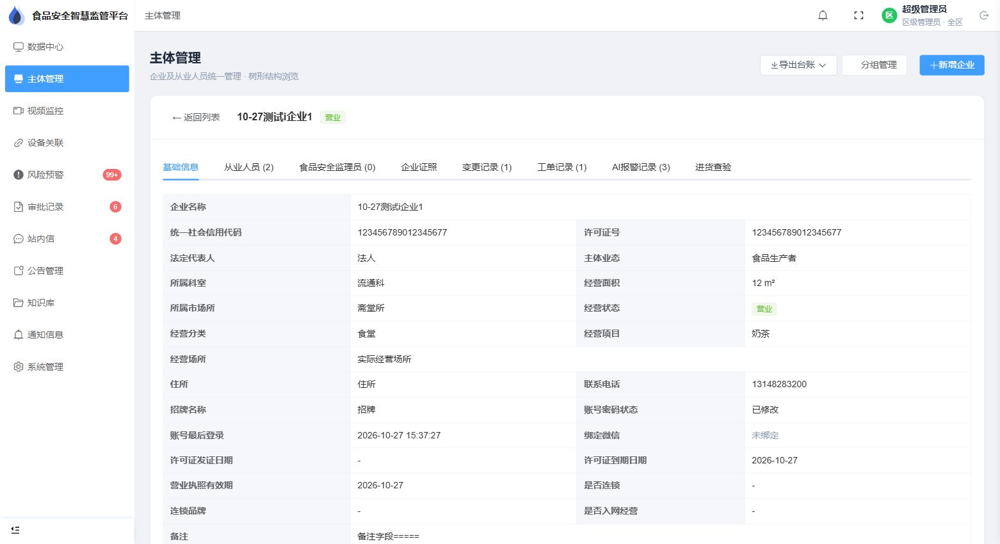{width=15cm}

点击列表中「详情」进入企业档案页，顶部显示企业名称与营业状态，下方共 8 个页签：

| 页签 | 内容 |
|---|---|
| 基础信息 | 名称、信用代码、许可证号、法人、主体业态、所属科室、经营面积、市场所、经营状态、经营分类/项目、经营场所、住所、联系电话、招牌名称、账号密码状态、账号最后登录、绑定微信、许可证发证/到期日期、营业执照有效期、是否连锁、连锁品牌、是否入网经营、备注 |
| 从业人员 (N) | 姓名、联系电话、身份证号、健康证编号、健康证到期日、健康证状态（有效 / 即将到期 / 已过期），可在下方表单继续添加人员 |
| 食品安全监理员 (N) | 监理员姓名、职务、培训证书编号 |
| 企业证照 | 许可证编号、发证日期、到期日期、许可证照片、营业执照照片、营业执照有效期；可「添加证照」 |
| 变更记录 (N) | 历次主体信息变更（字段、变更前后值、时间） |
| 工单记录 (N) | 工单编号、来源、工单类型、紧急程度、状态、提交时间 |
| AI 报警记录 (N) | 预警名称、风险等级、处理状态、触发时间、描述（如「从业人员张 X 健康证已过期，健康证编号 1，有效期截止 2026-10-27」） |
| 进货查验 | 商户端上传的进货查验记录：货物名、详细介绍（含附件）、编辑时间 |

页首「← 返回列表」可回到台账。

### 3.4 视频监控

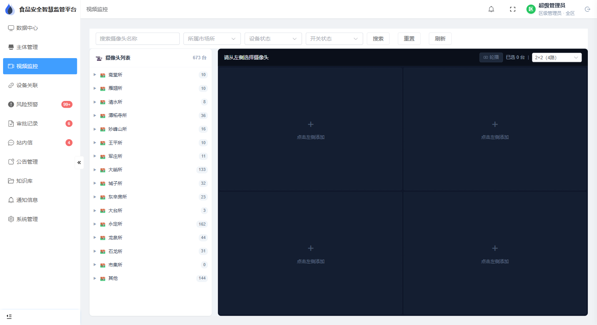{width=15cm}

视频监控用于非现场监管，远程查看辖区企业后厨实时画面。

**左侧摄像头树**

1. 顶部筛选：所属市场所、设备状态、开关状态，点击「搜索」筛选，「刷新」重新拉取设备。
2. 树形结构为 **市场所（摄像头数）→ 企业 → 摄像头**，点击「▶」逐级展开；摄像头名称后图标表示在线（🟢）/ 离线（🔴）/ 状态未知（❔），点击「详情」查看设备信息。
3. 树右上角显示设备总数（如 673 台）。

**右侧预览区**

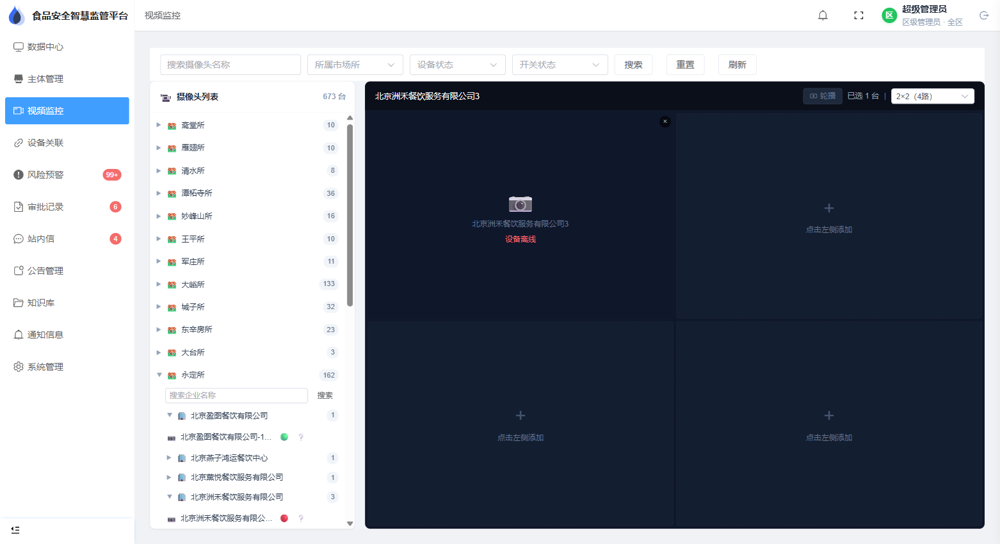{width=15cm}

1. 点击左侧任一摄像头，即加入预览格（最多 4 路，2×2）并开始拉流。
2. 顶部显示已选台数；「轮播」可自动轮换已选画面。
3. 画面内显示设备名称、状态（在线 / 离线）。设备离线时提示「设备离线」，可在「设备关联」中核对设备在线状态与关联关系。
4. 无画面时显示「请从左侧选择摄像头」及「点击左侧添加」占位框；右上角「×」可移除该路画面。

### 3.5 设备关联

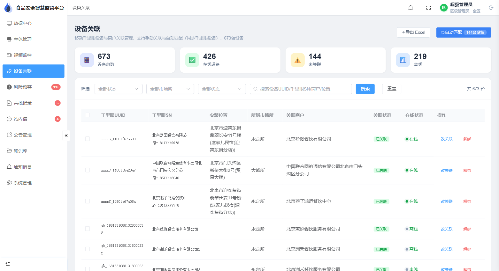{width=15cm}

设备关联用于「移动千里眼」设备与商户的绑定管理，页面说明为「移动千里眼设备与商户关联管理，支持手动关联与自动匹配（同步千里眼设备）」。

**统计卡（4 张）**：设备总数 / 在线设备 / 未关联 / 离线。

**操作按钮**

| 按钮 | 作用 |
|---|---|
| 导出 Excel | 导出设备台账（设备编号、安装位置、所属市场所、关联商户、关联/在线状态） |
| 自动匹配 | 同步千里眼设备后按规则自动匹配商户，匹配结果需核对 |

**筛选区**：关联状态（全部 / 已关联 / 未关联）、所属市场所、在线状态，另有「搜索 / 重置」。

**列表列**：千里眼 UUID、千里眼 SN、安装位置、所属市场所、关联商户、关联状态、在线状态、操作。

| 当前状态 | 可用操作 |
|---|---|
| 已关联 | 改关联（换绑到其他商户）、解绑 |
| 未关联 | 手动关联（搜索并选择商户） |

> 📌 改关联 / 解绑均有二次确认；解绑后该设备不再向对应商户推送画面与告警。

### 3.6 风险预警

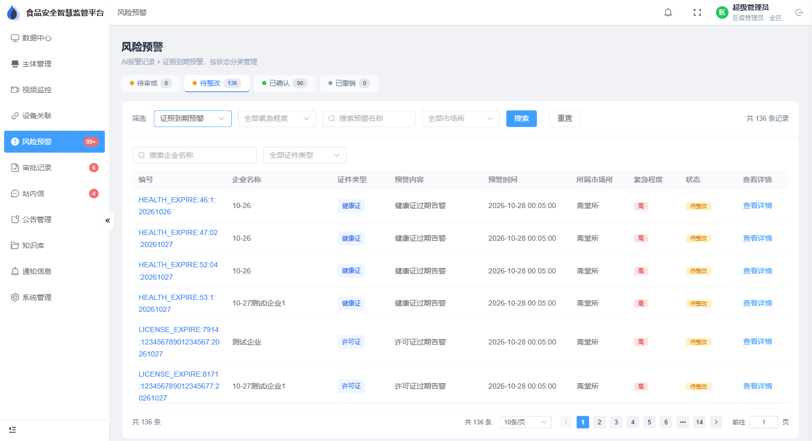{width=15cm}

风险预警汇集 **AI 报警记录** 与 **证照到期预警**，按状态分类管理，页面副标题为「AI 报警记录 + 证照到期预警，按状态分类管理」。

**状态页签（带数量）**：待审核 / 待整改 / 已确认 / 已撤销。点击页签切换该状态下的记录。

**筛选区**

| 预警来源 | 可选筛选 |
|---|---|
| AI 报警记录 | 全部紧急程度（高 / 中 / 低）、全部检测类型（未戴帽子/头套、未戴口罩、未戴手套、抽烟、玩手机、明火、鼠患）、全部市场所、搜索预警名称 |
| 证照到期预警 | 全部紧急程度、全部市场所、全部证件类型（健康证 / 许可证 / 营业执照）、搜索预警名称 |

**列表列**

- AI 报警记录：编号、报警时间、企业名称、所属市场所、检测类型、置信度、紧急程度、状态、查看详情。
- 证照到期预警：编号、企业名称、证件类型、预警内容（如「健康证过期告警」）、预警时间、所属市场所、紧急程度、状态、查看详情。

> 📌 编号可追溯来源：`HEALTH_EXPIRE:…`（健康证）、`LICENSE_EXPIRE:…`（许可证）、`BUSINESS_LICENSE_EXPIRE:…`（营业执照）。

**详情与人工确认**

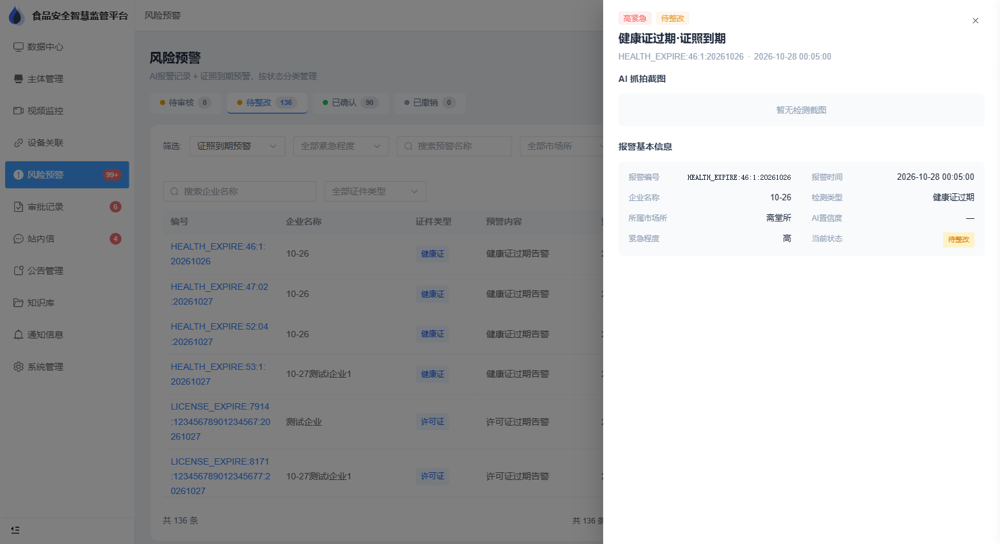{width=15cm}

点击「查看详情」打开右侧抽屉，自上而下为：

1. 紧急程度标签、当前状态、类型与编号、时间。
2. **AI 抓拍截图**（AI 报警）：展示抓拍画面与检测框；证照预警显示「暂无检测截图」。
3. **报警基本信息**：报警编号、报警时间、企业名称、检测类型、所属市场所、AI 置信度（证照预警为「—」）、紧急程度、当前状态。
4. **人工确认区**（仅「待审核」出现）：提示「请对此 AI 报警进行人工复核，确认后将其转为待整改状态进入预警列表，不采纳则抛弃该预警」，下方两个按钮：
   - **确认采纳** → 状态转为「待整改」，提示「已确认采纳」；
   - **不采纳** → 状态转为「已撤销」，提示「已标记不采纳」。

> 📌 已完成人工复核的预警不能再修改确认结果，系统会提示「该预警已完成人工复核，不能再修改确认结果」。

### 3.7 审批记录

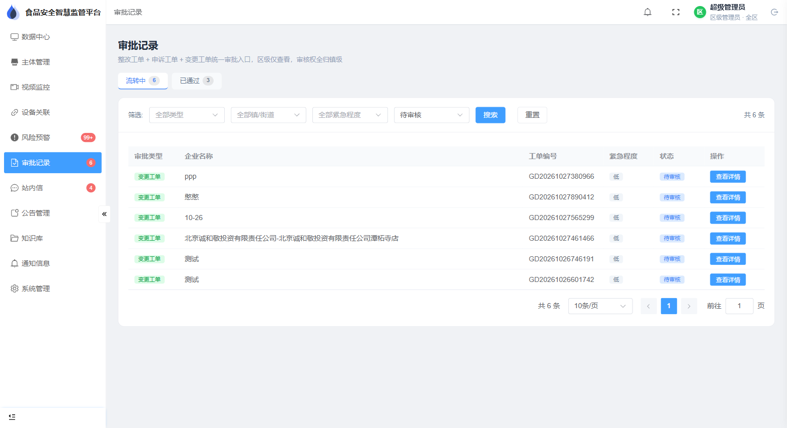{width=15cm}

审批记录是整改工单、申诉工单、变更工单的统一审批入口。页面副标题随角色变化：区级为「区级仅查看，审核权全归镇级」。

**视图切换**：流转中（待审核 + 已驳回）/ 已通过。

**筛选区**：审批类型（整改工单 / 申诉工单 / 变更工单）、全部镇／街道、全部紧急程度、全部处理状态、搜索、重置。

**列表列**：审批类型、企业名称、工单编号、紧急程度、状态、操作（查看详情）。

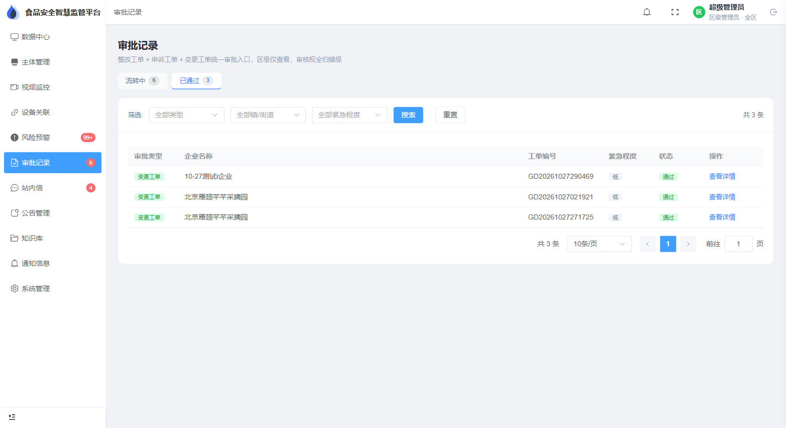{width=15cm}

**审批详情**

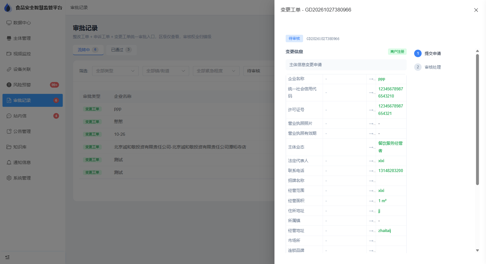{width=15cm}

点击「查看详情」打开抽屉：

1. 标题为「工单类型 - 工单编号」，右上角显示当前状态。
2. **业务内容区**：
   - 变更工单：逐字段展示「原值 → 新值」对比（企业名称、统一社会信用代码、许可证号、主体业态、法定代表人、联系电话、经营面积、所属镇、经营地址、状态、备注等）。
   - 整改工单：展示预警信息（预警标题、预警内容）与商户提交的整改说明、整改照片。
   - 申诉工单：展示申诉说明与证据材料。
3. **操作记录**：以步骤条呈现流转轨迹（1 提交申请 → 2 审核处理），含时间与操作人。
4. **审批操作区**（镇级账号在「待审核」状态下可见）：填写审批意见（**驳回时必填，限 500 字**），点击「审批通过」或「驳回」，系统二次确认后生效。

> 📌 区级账号在此处仅可查看，无审批按钮；如需调整审批结果，请联系对应市场所管理员。

### 3.8 站内信

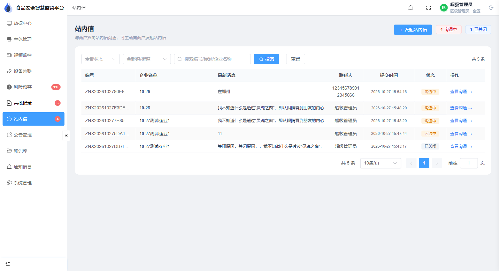{width=15cm}

站内信用于与商户双向沟通，页面副标题为「与商户双向站内信沟通，可主动向商户发起站内信」。

**列表**

1. 顶部统计与页签：沟通中 / 已关闭（带数量）。
2. 筛选：全部状态、全部镇／街道、搜索、重置。
3. 列表列：编号（如 ZNX20261027…）、企业名称、最新消息（摘要）、联系人、提交时间、状态、操作（查看沟通 →）。

**发起站内信**

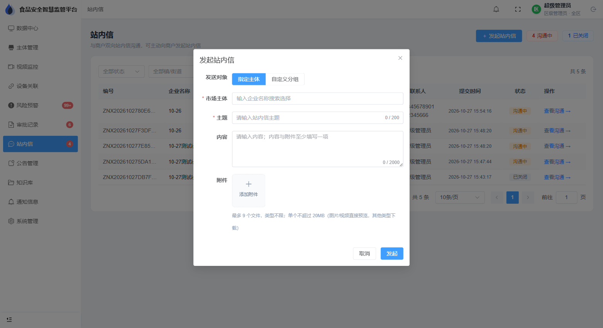{width=15cm}

1. 点击「＋ 发起站内信」。
2. **发送对象**：选择「指定主体」（输入企业名称搜索并选择）或「自定义分组」（选择已建分组）。
3. 填写**主题**（0/200 字）、**内容**（0/2000 字）。
4. 可选「添加附件」：最多 9 个文件，类型不限，单个不超过 20MB（图片/视频可直接预览，其他类型可下载）。
5. 点击「发起」，提示「已发起，等待商户回复」。

**查看与回复**

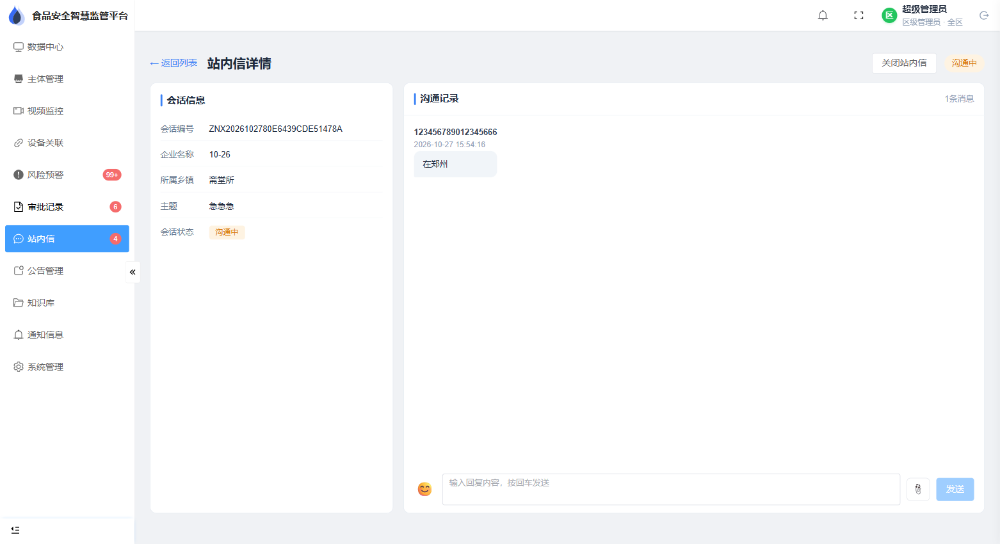{width=15cm}

1. 点击「查看沟通 →」进入会话页，左侧为**会话信息**（会话编号、企业名称、所属乡镇、主题、会话状态），右侧为**沟通记录**。
2. 在底部输入框输入内容，「😊」插入表情，「📎」上传附件，按回车或点击「发送」。
3. 点击「关闭站内信」可结束会话，需填写关闭原因（选填，限 500 字）；关闭后该会话不可再回复。

### 3.9 公告管理

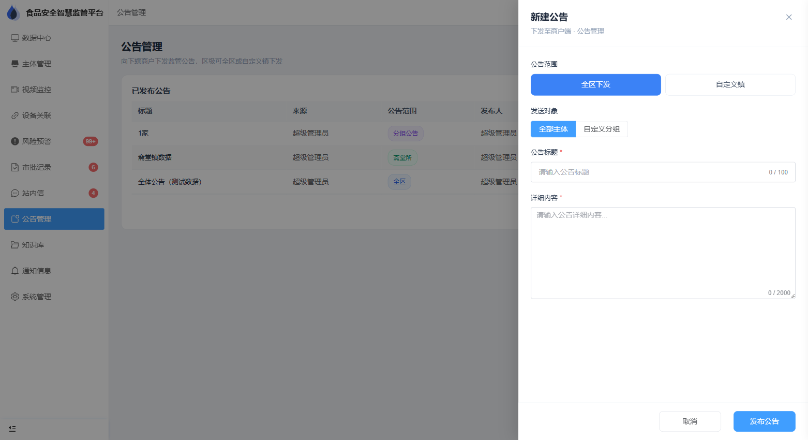{width=15cm}

公告管理用于向下辖商户下发监管公告，页面副标题为「向下辖商户下发监管公告，区级可全区或自定义镇下发」。

**公告列表**：页签「已发布公告」，列包括标题、来源、公告范围、发布人、发布时间、状态、操作（查看详情 / 删除）。

> 📌 只能删除本人创建的公告，他人公告无删除权限。

**新建公告**

1. 点击「新建公告」，弹窗标题为「新建公告 · 下发至商户端 · 公告管理」。
2. **公告范围**：`全区下发`（区级可用）/ `自定义镇`（选择下发镇/街道；镇级默认本镇）。
3. **发送对象**：`全部主体` / `自定义分组`（选择一个或多个分组）。
4. 填写**公告标题**（0/100 字）与**详细内容**（0/2000 字）。
5. 点击「发布公告」，提示「公告发布成功」，公告即时出现在商户端。

### 3.10 知识库

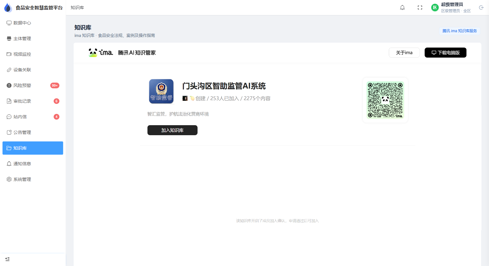{width=15cm}

知识库内嵌「腾讯 ima 知识库服务」，汇总食品安全法律法规、典型案例与操作指南，支持检索与阅读，用于日常执法参考与培训。该模块为外部服务集成，页面内容由 ima 知识库提供。

### 3.11 通知信息

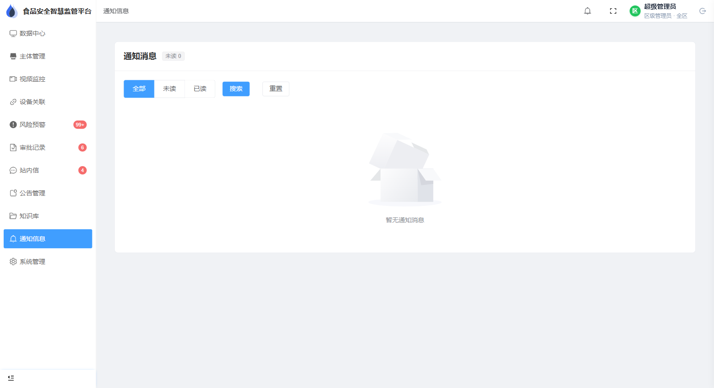{width=15cm}

通知信息是平台内部消息中心，用于接收系统提醒（如 AI 报警（红色严重）、证照到期、工单审批完成等）。

1. 顶部显示未读数，页签为全部 / 未读 / 已读。
2. 支持关键词搜索、重置。
3. 点击单条通知即标记为已读，也可使用「全部标记为已读」批量处理。

> 📌 通知信息是「系统 → 你」的单向提醒；与商户沟通请使用「站内信」。

### 3.12 系统管理

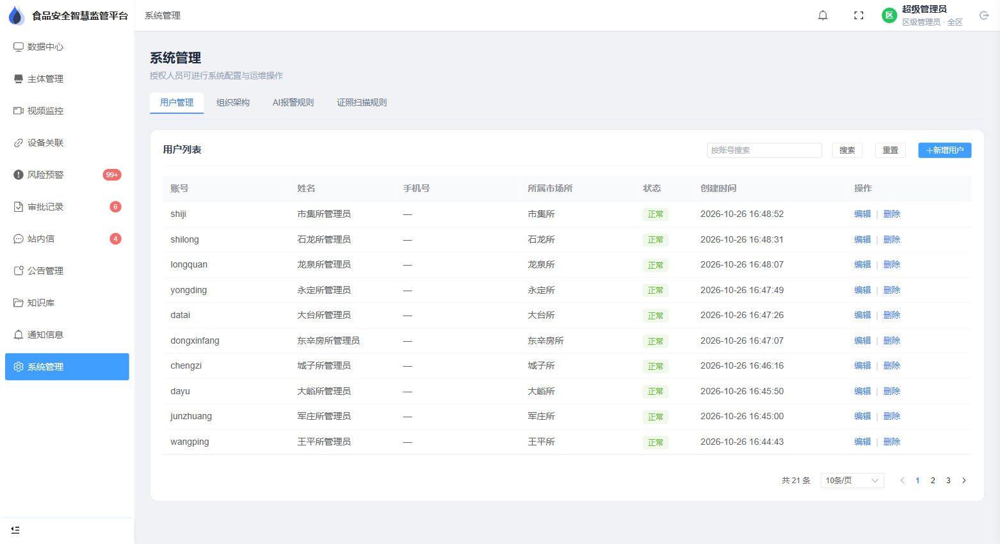{width=15cm}

系统管理仅区级可见，副标题为「授权人员可进行系统配置与运维操作」，共 4 个页签。

#### 用户管理

- 支持按账号搜索，「新增用户」创建账号（**仅超级管理员可新增**）。
- 列表列：账号、姓名、手机号、所属市场所、状态（正常 / 禁用）、创建时间、操作（编辑｜删除）。
- 新增/编辑用户字段：账号（必填）、姓名、手机号、角色（区级管理员 / 镇级管理员 / 商户负责人）、所属市场所、初始密码（必填）。

> 📌 每个市场所通常配置一个管理员账号（如 dayu = 大峪所管理员、yongding = 永定所管理员），实现「一镇一账号」。

#### 组织架构

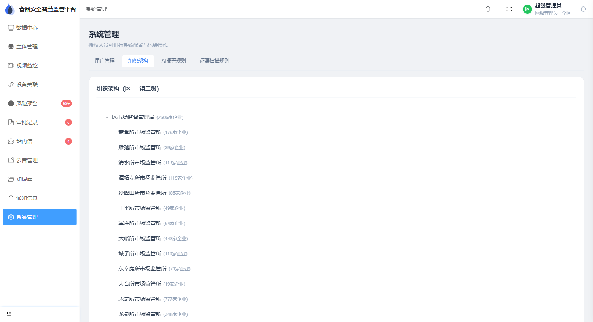{width=15cm}

展示「区 — 镇」二级组织树，节点后标注该层级企业数，便于掌握辖区主体分布：

区市场监督管理局（2,606 家）→ 斋堂所 179、雁翅所 89、清水所 113、潭柘寺所 119、妙峰山所 86、王平所 49、军庄所 64、大峪所 443、城子所 110、东辛房所 71、大台所 19、永定所 777、龙泉所 348、石龙所 66、市集所 73。

#### AI 报警规则

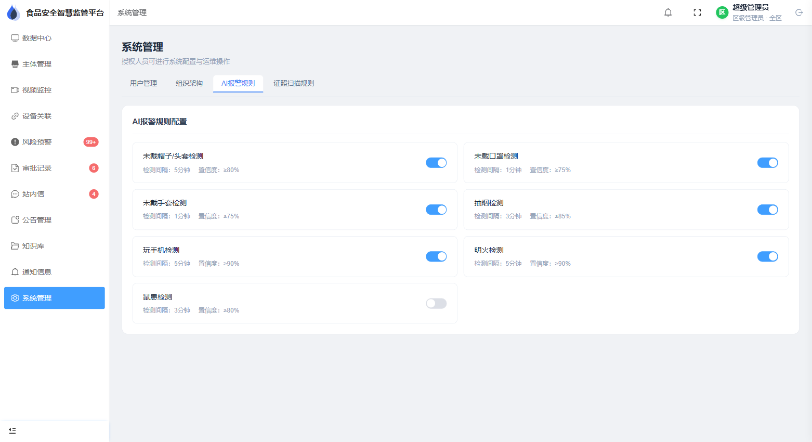{width=15cm}

列出 7 类检测规则（未戴帽子/头套、未戴口罩、未戴手套、抽烟、玩手机、明火、鼠患），每类可查看/调整**检测间隔**与**置信度阈值**（见 [2.4 系统内置规则](#24-系统内置规则)），修改后点击「保存」。

#### 证照扫描规则

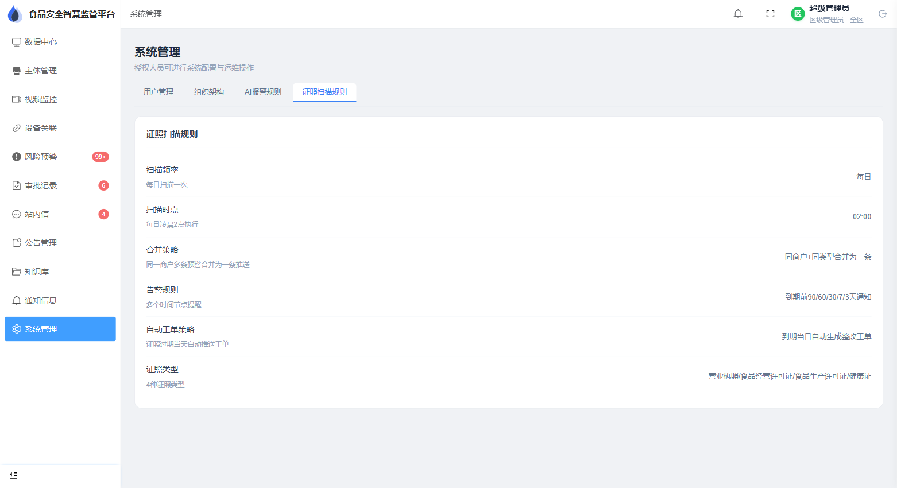{width=15cm}

展示证照扫描的 5 项配置与证照类型（扫描频率、扫描时点、合并策略、告警规则、自动工单策略、4 类证照），用于向使用人员说明预警产生逻辑，本页为只读展示。

### 3.13 常见问题（FAQ）

**Q1：为什么我在审批记录里看不到「审批通过 / 驳回」按钮？**
答：审核权仅授予镇级管理员。区级账号在所有工单上均为只读（页面提示「区级仅查看，审核权全归镇级」），请使用对应市场所的镇级账号完成审核。

**Q2：风险预警里切到「AI 报警记录」没有数据，但页签显示有数量？**
答：页签数量按当前来源统计。证照到期预警需在筛选区把来源切到「证照到期预警」查看；若某状态下确实无记录，列表会显示「该状态下暂无报警记录」。

**Q3：AI 报警怎么从「待审核」转到「待整改」？**
答：打开详情，在「人工确认」区点击「确认采纳」；点击「不采纳」则转为「已撤销」。已复核的记录不能再改，需在流程上另行处理。

**Q4：证照到期预警是什么时候产生的？**
答：系统每日凌晨 02:00 扫描一次，在到期前 90 / 60 / 30 / 7 / 3 天生成提醒；证照过期当天自动生成整改工单。

**Q5：同一家企业为什么有时只收到一条证照预警？**
答：系统对同一商户、同一证件类型的多条预警做了合并，避免重复推送。

**Q6：设备显示「未关联」怎么处理？**
答：在「设备关联」中点击该行「手动关联」，搜索并选择商户后确认；也可先执行「自动匹配」，再逐条核对。

**Q7：视频监控画面显示「设备离线」怎么办？**
答：先在「设备关联」核对设备的在线状态与关联商户；若设备离线，需联系设备维护方检查网络与设备供电，平台侧无法强制上线。

**Q8：为什么看不到同事建的分组？**
答：分组按创建人隔离，只能查看与管理自己创建的分组；镇级账号只能圈选本镇主体。

**Q9：公告为什么删不掉？**
答：只能删除本人创建的公告，他人公告需由创建人删除。

**Q10：新密码总是提示格式不符？**
答：密码需 8–18 位，且为数字、字母、符号中的任意两种组合，不能是纯数字、纯字母，也不能包含中文。

### 3.14 注意事项

1. **权限边界**：区级负责统筹与配置，不越权审批；镇级负责本所数据与工单审核，一镇一账号，勿共用账号。
2. **处置时效**：「待审核」预警与「待审核」工单请在工作日内及时处理，避免积压（导航角标显示待处理数量）。
3. **驳回须说明**：驳回工单必须填写审批意见（限 500 字），说明整改要求，便于商户一次整改到位。
4. **数据准确**：新增企业时统一社会信用代码须为 18 位，市场所、主体业态、经营方式直接影响统计与分派，请谨慎选择。
5. **证照维护**：证照照片请上传清晰原件照片（JPG/PNG，≤10MB），到期日期须与证件一致，否则预警节点会失真。
6. **台账导出**：导出内容为原值未脱敏，涉及主体与人员信息，请按内部数据安全要求保管，不得外传。
7. **设备与视频**：「自动匹配」结果需人工核对后再执行；解绑设备前确认商户已停止使用该点位。
8. **公告与站内信**：下发前核对范围（全区 / 指定镇 / 分组），避免误发；公告与站内信内容将直接触达商户端。
9. **账号安全**：初始密码请首次登录后立即修改；人员岗位调整时及时在「用户管理」中禁用或删除账号。

---

*本手册依据「食品安全智慧监管平台」线上试运行环境（2026-10-28）实际界面与菜单编写，如界面或流程更新，请以系统实际页面为准。*
